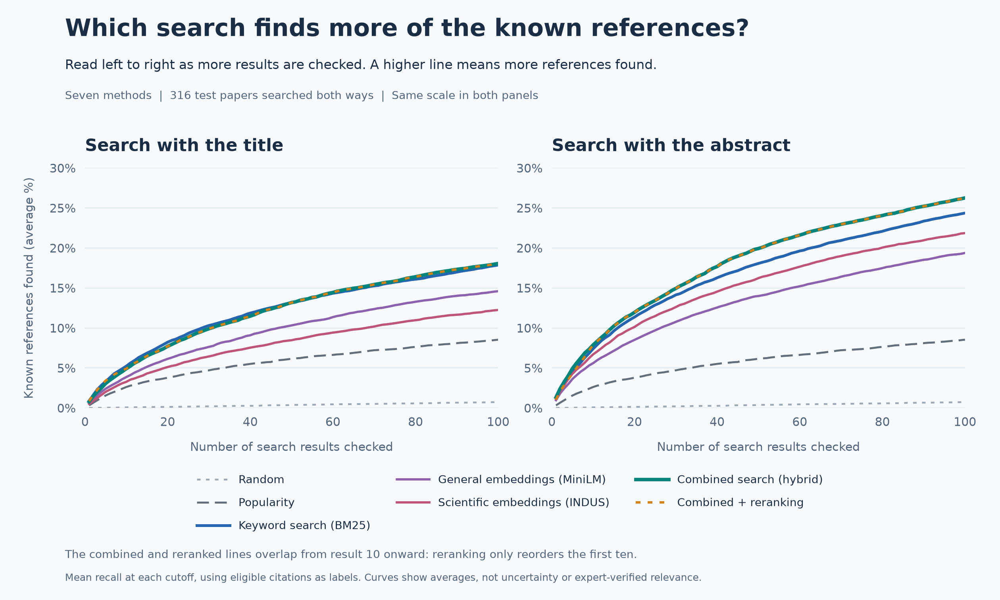

# Evaluating RAG Retrieval Using Astronomy Papers

RAG (Retrieval-Augmented Generation) systems search for relevant documents before using them to help generate an answer. I built this project to compare seven search methods used in that retrieval step, from keyword search to embeddings, hybrid search and reranking.

I evaluated them on a collection of 16,649 astronomy papers, using paper titles and abstracts as searches and checking how many cited papers each method found.

Main finding: combining keyword and embedding search improved abstract searches. For titles, the improvement was inconclusive.

[Full report](docs/report.md) | [Source code](src/astro_retrieval/)

## The experiment

1. Use a paper's title or abstract as the search text.
2. Have each method return up to 100 papers.
3. Count how many of the original paper's eligible references it found.
4. Repeat across 316 test papers, using both titles and abstracts.

A separate 154 papers were used to choose settings before the final test. Every result must have a valid publication date strictly earlier than the search paper, excluding the paper itself, same-day publications and unknown dates.

The data came from OpenAlex, using titles, abstracts, dates and references rather than full PDFs. I sampled 600 exoplanet-related articles from 2021-2025, of which 557 had usable abstracts. Adding their referenced papers brought the collection to 16,649. The 470 development and test papers each had at least eight eligible references.

## Search methods

An embedding is a list of numbers a model produces from text. Comparing embeddings can help find related papers even when they use different words.

| Method | What it does |
| --- | --- |
| Random | Picks papers randomly to show chance performance. |
| Popularity | Favors papers cited more often by earlier papers in the sampled collection. |
| Keyword search (BM25) | Matches words, giving more weight to distinctive terms. |
| MiniLM | Searches using embeddings from a general text model. |
| INDUS | Searches using embeddings from a scientific text model. |
| Combined search (hybrid) | Merges the BM25 and INDUS rankings, rewarding papers near the top of either list. |
| Combined search with reranking | Uses another model to read the query and each of the first ten results together, then reorder those ten. |

## Results

The main score is recall, the share of known references found. If 20 references are available and eligible, and the search finds five, recall is 25%. Recall@100 checks the first 100 results. It measures references recovered, not the percentage of returned results that are useful.



Move right to include more results. Higher lines find more references, averaged across the 316 test papers. Both panels use the same scale. Combined search and reranking overlap from result ten onward because reranking only rearranges the first ten papers.

| Search text | Keyword Recall@100 | Combined Recall@100 | Finding |
| --- | ---: | ---: | --- |
| Title | 17.9% | 18.1% | Improvement inconclusive |
| Abstract | 24.4% | 26.3% | Gain of 1.9 percentage points supported |

The planned statistical tests compared methods on the same papers and accounted for multiple comparisons. The curves show averages, with uncertainty intervals and full comparisons in the [report](docs/report.md).

- Embedding search alone did not beat keyword search on Recall@100 for either titles or abstracts.
- Reranking had mixed results: it improved the top-ten ordering score for titles but reduced it for abstracts. Rearranging results cannot increase recall over the full list of 100.

## Limitations

Citations are an imperfect measure of relevance: useful papers may go uncited. A small review using two model judges illustrated this limitation, but their judgments are not expert verification. This study also covers only exoplanet papers and title/abstract searches, and possible overlap with model training data was not ruled out.

## What I built

The Python pipeline collects papers, runs searches, evaluates results and analyzes saved judge replies. Completed downloads and model outputs are cached so interrupted work can resume.

I implemented the keyword scorer, ranking combination and evaluation calculations directly, using pretrained models for embeddings and reranking. Search inference ran locally on CPU with 32 GB RAM. Judging was done separately through the ChatGPT and Gemini apps.

| Tools | Purpose |
| --- | --- |
| Python and SQLite | Collection, paper storage and saved requests |
| NumPy | Numerical calculations and embedding comparisons |
| Sentence Transformers, Transformers and PyTorch | Running pretrained models |
| pytest | Checking calculations, data rules and failure handling |

## Run locally

Verified on Windows with Python 3.14.4. The package allows Python 3.11+, but the full experiment was verified in the recorded environment. From the project folder in PowerShell:

```powershell
py -3.14 -m venv .venv
.\.venv\Scripts\python.exe -m pip install -e ".[dev,models]"
.\.venv\Scripts\python.exe -m pytest -q
.\.venv\Scripts\python.exe -m astro_retrieval
```

The tests use small examples and simulated model responses, so they need no API key or model weights. Installation includes model libraries such as PyTorch and can be large.

The last command previews collection settings. Live collection requires `--collect` and credentials in a local, Git-excluded `.env` file.

### Reproduce the saved experiment

A fresh clone cannot reproduce the full experiment alone. The original database, embeddings, cached scores and raw judging replies are stored locally and are not distributed in the repository. Reproduction also requires the unchanged local protocol files, `docs/hypotheses.md` and `docs/audit-rubric.md`.

With those original files present, verify saved results without changing files:

```powershell
.\.venv\Scripts\python.exe -m astro_retrieval --reproduce
```

Or rebuild the rankings and analysis into a new folder:

```powershell
.\.venv\Scripts\python.exe -m astro_retrieval --reproduce --output data/reproduced-new
```

The output folder must be new, have an existing parent, and be separate from the source data. Missing or changed inputs stop the run. The rebuild uses saved model outputs without network or model calls and publishes results only after matching the originals.

The verified rebuild took 5 minutes 28 seconds, excluding initial downloads, model runs and judging. Downloading fresh data would create a new experiment.
