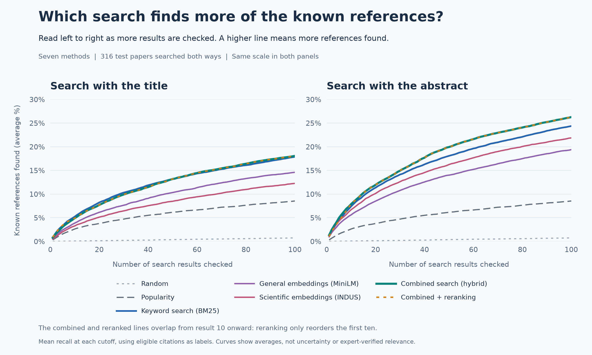
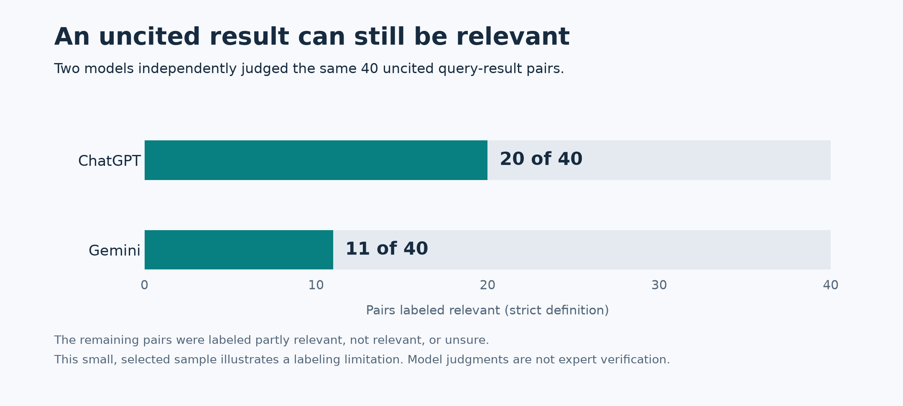

# Astronomy Paper Search Evaluation: Results

Combining keyword and embedding search found more cited papers when searching with abstracts. For titles, the improvement was inconclusive. Reranking helped title ordering but made abstract ordering worse.

This report covers the experiment completed on October 27, 2026. The [README](../README.md) explains the project and how to run the code.

## Experiment

I compared seven search methods used in the retrieval step of RAG: random, popularity, keyword search (BM25), general embeddings (MiniLM), scientific embeddings (INDUS), combined search and reranking. Combined search merges BM25 and INDUS rankings. Reranking reorders its first ten results using another model.

The collection contains 16,649 astronomy papers from OpenAlex. It started with 600 exoplanet-related articles from 2021-2025, of which 557 had usable abstracts, then added their referenced papers.

I used 154 papers to choose settings and 316 separate papers for testing. Each test paper supplied two searches: its title and its abstract. Every method searched the same collection and could return only papers with valid dates strictly earlier than the search paper.

## Search results

The main measure is Recall@100, the share of a paper's eligible references found in the first 100 results. Finding five of 20 references gives 25% recall. It does not mean that 25% of the returned results are useful.

Higher lines mean more references recovered as more results are checked. Scores are averaged equally across the 316 test papers. The curves show averages, not uncertainty intervals.

| Search text | Keyword search | Combined search | Result |
| --- | ---: | ---: | --- |
| Title | 17.9% | 18.1% | Improvement inconclusive |
| Abstract | 24.4% | 26.3% | Improvement of 1.9 percentage points supported |

Embedding search alone recovered fewer references than BM25 for both forms. Combining the rankings helped on abstracts, but the results do not support a general claim that hybrid search improves both forms. Popularity beat random search and still trailed BM25.

## Reranking

Reranking keeps the same papers and only changes the first ten positions. That is why its recall curve overlaps combined search from result ten onward.

To measure ordering, I used nDCG@10, which rewards placing cited papers near the top. Higher is better.

| Search text | Combined search | After reranking |
| --- | ---: | ---: |
| Title | 0.3286 | 0.3375 |
| Abstract | 0.5076 | 0.4812 |

Reranking improved title ordering but reduced abstract ordering. Most abstract query-document pairs exceeded the model's 512-token limit and were shortened. That is a possible constraint, but this experiment does not establish it as the cause. Splitting long text into chunks did not outperform ordinary truncation in development testing.

## Confidence in the results

Settings were chosen before testing. The four planned comparisons below use paired tests on the same papers, with Holm correction for multiple comparisons. A positive difference favors the first method or condition.

| Comparison | Mean difference | 95% interval | Adjusted p-value |
| --- | ---: | --- | ---: |
| Combined minus keyword, title Recall@100 | 0.001936 | -0.003782 to 0.007793 | 0.514349 |
| Combined minus keyword, abstract Recall@100 | 0.018933 | 0.012645 to 0.025166 | 0.000400 |
| Title reranking gain minus abstract gain, nDCG@10 | 0.035289 | 0.021876 to 0.047980 | 0.000400 |
| Popularity minus random, Recall@100 | 0.078019 | 0.069661 to 0.086547 | 0.000400 |

Differences are in score units: 0.01 recall equals one percentage point. The title interval includes zero, so the small observed gain is inconclusive. The reranking comparison shows a greater benefit for titles than abstracts, not an improvement for both.

Intervals use 2,000 paper-level bootstrap resamples. The paired sign-flip tests use 10,000 draws, seed 42 and a significance threshold of 0.05. The intervals themselves are not adjusted for multiple comparisons. Other differences discussed above are descriptive.

## Citation review

A useful paper can go uncited and receive no credit in this evaluation. To explore that limitation, ChatGPT and Gemini each judged the same 60 query-result pairs: 40 uncited and 20 cited. They saw titles and abstracts with citation status, search method and rank hidden.

The models agreed on 38 of the 60 labels. Their judgments suggest that citations miss some useful results, but the models can share mistakes and the sample was deliberately selected.

Only one title query and no abstract queries had enough shared judged candidates for the planned comparison between search methods. The review cannot establish a new winning method or replace expert evaluation.

## Limitations

The strongest result is a modest improvement in abstract reference recovery from combined search. More complex methods did not consistently improve either coverage or ordering.

The scope is limited to exoplanet papers and title/abstract searches. Missing abstracts, references and uncertain publication dates affect the collection. Possible overlap with model training data was not ruled out. Citation scores and model judgments therefore support conclusions about this experiment, not search quality across astronomy or the quality of generated RAG answers.

## Reproduction

The code can verify saved results and rebuild rankings from cached model outputs without network access or new inference. The verified rebuild took 5 minutes 28 seconds on a CPU with 32 GB RAM and matched the originals.

A fresh clone cannot reproduce the experiment alone. The paper data, embeddings, scores, judge replies and frozen protocol files remain local. See the [README](../README.md) for the required artifacts and commands. The full metric outputs are retained locally in `data/test/report.json` and `data/audit/model-main/analysis.json`.
